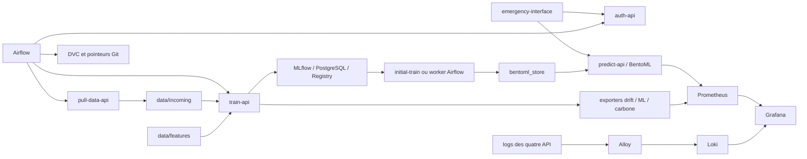

# Accidents MLOps

Stack de démonstration pour prédire la gravité binaire d’un accident routier BAAC, suivre les modèles dans MLflow et simuler l’arrivée de lots hebdomadaires 2024.

## Architecture



Le point d’entrée est [Makefile](Makefile) ; les services actifs sont `train-api` et `predict-api`, sans suffixe de version. Les quatre Compose communiquent sur `accidents-shared-network`. La présentation Streamlit est un serveur local distinct, lancé au premier plan.

| Composant | Adresse locale | Fonction |
| --- | --- | --- |
| emergency-interface | http://localhost:3001 | Interface React/Express et proxy de prédiction |
| Présentation | http://localhost:8501 | Huit pages Streamlit |
| auth-api | http://localhost:8005/docs | JWT login/pull/train |
| pull-data-api | http://localhost:8006/docs | Collecte de lots Parquet |
| train-api | http://localhost:8010/docs | Training initial/weekly, monitoring et Registry |
| predict-api | http://localhost:8009 | Prédiction et reload BentoML |
| MLflow | http://localhost:5001 | Tracking et Registry |
| Airflow | http://localhost:8080 | DAGs et état d’orchestration |
| Prometheus / Grafana | http://localhost:9090 / http://localhost:3000 | Métriques et dashboards |
| Exporters drift/carbone/ML | ports 8001 / 8002 / 8003 | `/health` et `/metrics` |

Loki est accessible aux services sur `loki:3100`, sans port hôte publié. Les ports internes des quatre API sont 8000. Le port hôte MLflow peut être changé avec `MLFLOW_PORT`.

## Prérequis et environnement

- Docker et le plugin Compose, GNU Make, Git et `uv` ; Python 3.12 pour les commandes locales.
- Le bootstrap a été validé avec 16 Go alloués à Docker Desktop. L’essai à 8 Go avec la stack complète a subi un OOM.
- Accès DagsHub pour le dataset téléchargé par la collecte et pour les données DVC.

```bash
make install
```

Cette commande crée `.env` depuis [.env.example](.env.example) s’il manque, sans écraser un fichier existant, puis installe les dépendances verrouillées avec l’extra monitoring. L’exemple reprend les 50 variables de la configuration locale, avec des valeurs publiques ou des placeholders. Le compléter avant de démarrer :

| Groupe | Variables et rôle |
| --- | --- |
| Authentification | `USERS`, `ADMIN_USERS`, `PULL_USERS`, `TRAIN_USERS` : comptes et permissions ; trois `JWT_SECRET_*` distincts, `JWT_ALGORITHM` |
| Jobs | `TRAIN_USERNAME` / `TRAIN_PASSWORD`, `PULL_USERNAME` / `PULL_PASSWORD`, `AIRFLOW_SERVICE_USERNAME` / `AIRFLOW_SERVICE_PASSWORD` : comptes autorisés ; `INITIAL_IDEMPOTENCY_KEY` pour le bootstrap |
| Collecte et DVC | `DAGSHUB_USERNAME` / `DAGSHUB_TOKEN` pour le collecteur ; credentials du remote DVC dans `.dvc/config.local`, configurés séparément |
| Publication Git | `GIT_AUTHOR_*`, `GIT_COMMITTER_*`, `DVC_GIT_REMOTE`, `GIT_PUSH_TOKEN` : identité et accès du worker, avant activation des DAGs |
| MLflow | `MLFLOW_DB_*`, `MLFLOW_PORT`, `MLFLOW_TRACKING_URI`, `MLFLOW_EXPERIMENT_NAME`, `MLFLOW_REGISTERED_MODEL_NAME`, `MLFLOW_CHAMPION_ALIAS`, `MLFLOW_ALLOWED_HOSTS` |
| Airflow et alertes | `FERNET_KEY`, `AIRFLOW_UID`, `GF_SLACK_WEBHOOK` : clé Airflow, propriétaire et webhook Slack à renseigner |

`DVC_PUSH_ENABLED` et `ACCIDENT_MODEL_SOURCE` restent dans l’exemple pour refléter le fichier local, mais le code actif ne les lit pas. Les valeurs de démonstration servent au développement local. `.env`, `.dvc/config.local` et la configuration Airflow générée restent privés.

Les URLs du DAG utilisent le DNS Docker, pas les ports hôte : `AUTH_API_URL=http://auth-api:8000/login`, `PULL_API_URL=http://pull-data-api:8000/pull_data`, `TRAIN_API_URL=http://train-api:8000/train` et `PREDICT_API_URL=http://predict-api:8000/reload`. Un `.env` issu de l’ancienne stack doit remplacer les hôtes `train-api-v2` / `predict-api-v2`.

Configurer le remote DVC local selon le [guide DVC](docs/ml/dvc.md), puis récupérer les données nécessaires :

```bash
make dvc-pull
```

Le fichier `data/features/data_final_binaire.csv` doit être présent pour entraîner. La collecte télécharge également ce dataset depuis DagsHub à son démarrage ; un échec distant empêche son service de démarrer.

## Démarrer et initialiser

Depuis un stockage MLflow/BentoML neuf :

```bash
make init
```

Ordre : MLflow → monitoring → quatre API et emergency-interface → entraînement/publication du champion → Airflow. Le monitoring n’est lancé qu’une fois. `initial-train` est un conteneur construit puis supprimé après son exécution ; ses modèles restent dans le volume BentoML.

Pour redémarrer avec un champion existant :

```bash
make stack-up
make stack-status
make predict-smoke
```

Dans un second terminal :

```bash
make presentation
```

Le port de présentation est configurable, par exemple `make presentation PRESENTATION_PORT=8502`. `Ctrl+C` arrête la présentation. Pour arrêter Docker en conservant toutes les données :

```bash
make stack-down
```

Make définit aussi `TRAIN_USERNAME=alice`, `TRAIN_PASSWORD=wonderland` et `INITIAL_IDEMPOTENCY_KEY=initial-bootstrap`, puis les exporte vers Compose. Les modifier uniquement dans `.env` ne remplace pas ces défauts Make : fournir une surcharge Make ou exporter les variables dans le terminal avant `make init` / `make initial-train`. Le compte utilisé doit appartenir à `TRAIN_USERS`. Pour une autre configuration, `make init ENV_FILE=.env.local` choisit le fichier à charger.

Les UID/GID Make sont stables à 1000:1000. Si les bind mounts/Git du poste utilisent un autre propriétaire, surcharger explicitement, sans lancer Make avec sudo :

```bash
make init LOCAL_UID=$(id -u) LOCAL_GID=$(id -g)
```

La valeur transmise à Airflow reste la même que celle des images train/bootstrap. Les valeurs dans `.env` servent aussi au lancement Compose direct, mais ne remplacent pas les défauts Make.

## Authentification et API

| Opération | Route | Jeton émis par auth-api |
| --- | --- | --- |
| Connexion | `POST :8005/login` | Identifiants et `token_type` |
| Collecte | `GET :8006/pull_data?week=N` | `pull` |
| Entraînement | `POST :8010/train` | `train`, rôle train |
| Prédiction | `POST :8009/predict` | `login` |
| Rechargement | `POST :8009/reload` | `train`, rôle train |

La prédiction utilise le JSON de [payload.json](payload.json), enveloppé dans `input_data`, et retourne `prediction`, `probability`, `model_version`. Le smoke s’authentifie sans afficher le jeton. Dans l’interface, `status=remote_api` prouve l’appel distant ; le secours heuristique peut être utilisé en cas d’exception réseau et ne valide pas le champion.

Le training exige une clé d’idempotence. Initial : `{"mode":"initial","idempotency_key":"initial-bootstrap"}`. Weekly : `{"mode":"weekly","week":1,"file_path":"/shared-data/accidents_2024_w01.parquet","idempotency_key":"<clé-unique>"}`. Une clé réussie retrouve le même résultat ; une clé en cours ou réutilisée pour des entrées différentes produit un conflit. Les réservations interrompues sont récupérées au démarrage.

Le modèle initial est promu uniquement si aucun champion n’existe. Ensuite, les candidats hebdomadaires sont comparés au champion ; seule une promotion déclenche la publication/recharge automatique. Le [guide training](docs/operations/train-api.md) décrit les contrats et erreurs.

## Données et workflow hebdomadaire

`make reproduce` prépare les données via DVC : nettoyage → préparation → features → snapshot. Le [guide pipeline](README_PIPELINE.md) décrit les quatre scripts. L’entraînement actif est réalisé directement par `src/train_api`, avec sa configuration `training_config.yaml` ; DVC reste utilisé pour les données, pas pour lancer une ancienne CLI de training.

Airflow conserve deux DAGs et partage leurs fonctions dans `accidents_workflow.py` :

- `pull_train` : lundi 03:00 UTC, semaine ISO de la date logique moins 36 (calendrier de simulation).
- `pull_weekly` : toutes les cinq minutes, compteur `last_processed_week`, arrêt après 12 semaines. Initialiser cette Variable à `0` avant la simulation.

Le chemin est collecte → DVC add/push → commit/push du pointeur Git → training → branche de promotion → publication BentoML/reload → synthèse. Avant activation, vérifier remote Git, branche, droits du worker, credentials et stockage DVC. Les nouveaux DAGs sont créés en pause. Les activer volontairement dans Airflow uniquement après cette configuration ; leur chemin normal publie des commits/push. Pendant une validation sans commits, les conserver en pause ou utiliser une copie isolée dont la publication Git est neutralisée. Voir [le guide Airflow](docs/airflow/process.md).

## Persistance et monitoring

| Chemin ou volume | Usage |
| --- | --- |
| `data/features` | Dataset binaire et snapshot DVC |
| `data/incoming` | Lots Parquet partagés collecteur/train/worker |
| `data/mlflow/postgres`, `data/mlflow/artifacts` | Base et artefacts MLflow |
| `data/train-api-v2/artifacts` | Artefacts de training persistants |
| `train_api_v2_state` | SQLite d’idempotence |
| `bentoml_store` | Modèles servis et pointeur courant |
| Volumes Airflow et monitoring | Métadonnées, métriques, dashboards, logs |

Les deux identifiants contenant v2 sont conservés volontairement pour préserver les données existantes. Les modèles MLflow anciens embarquent leur code Python ; leur chargement après renommage a été vérifié. Les classes `projet_accidents_mlops.features/modeling` restent disponibles pour les artefacts plus anciens, et `weekly_data` sert à la préparation DVC.

Train écrit les JSON drift/ML et le CSV carbone consommés par les exporters. Predict expose directement `/metrics`. Alloy collecte les quatre API via `org.accidents.stack=api`. Prometheus collecte six cibles. La [documentation monitoring](README_monitoring.md) détaille les flux et la limite connue de cAdvisor sur Docker Desktop/overlayfs : cible accessible, séries par conteneur absentes sur le poste testé.

## Commandes et validation

`make help` liste les commandes. Principales : `install`, `init`, `stack-up`, `stack-down`, `stack-status`, `stack-logs`, `presentation`, `initial-train`, `predict-smoke`, `monitoring-up/down`, `airflow-up`, `dvc-pull/push`, `reproduce`, `metrics`.

`make initial-train` permet de rejouer le bootstrap de manière idempotente sur une stack active. `make stack-logs` affiche les journaux récents ; vérifier les secrets avant partage.

`make metrics` appelle `dvc metrics show` ; le pipeline actuel ne déclare pas de métriques de modèle dans `dvc.yaml`. Les performances de training se consultent dans MLflow et via l’exporter ML.

Tests et limites de plateforme : [validation locale](docs/operations/local-validation.md). Les tests ML Linux vérifient OpenMP/LightGBM ; les doubles unitaires de services ne remplacent pas le smoke de prédiction réelle.

Validation du 13 octobre 2026, détaillée dans le [bilan du nettoyage](docs/changes/2026-10-13_main/validation-stack.md) : installation et initialisation sur stockage vierge, entraînements initial et hebdomadaire, publication initiale BentoML, collecte distante et DVC local réussis. Suite Linux : **261 tests réussis, 1 ignoré**. Après les changements d’environnement/exclusions : **11 tests ciblés réussis**, reconstruction et **23 services stables**, prédiction API/interface réelle, arrêt sans suppression de volumes. Aucun commit créé.

Limites : séries cAdvisor par conteneur absentes sur Docker Desktop testé ; tests ML locaux macOS limités par OpenMP ; rendu visuel navigateur non contrôlé ; push Git/DVC distant et livraison Slack non testés. Les vulnérabilités npm identifiées restent à traiter séparément. Ces résultats sont datés, pas une garantie pour toutes les plateformes.

## Exclusions et fichiers locaux

- [.gitignore](.gitignore) conserve `.env` et ses variantes `.env.*`, caches, dépendances, backups et états runtime hors Git ; `.env.example` et les métadonnées DVC restent versionnables.
- [.dockerignore](.dockerignore) protège le contexte racine utilisé par train, MLflow et les exporters. Chaque autre contexte actif possède ses propres règles : secrets, caches et logs exclus, fichiers nécessaires aux `COPY` conservés. Les données runtime sont fournies par les montages Compose.
- [.dvcignore](.dvcignore) exclut secrets, dépendances, caches, états MLflow/train/Airflow, backups et sorties de monitoring. Les datasets `data/raw`, `data/features`, `data/incoming` et `reports/snapshot_manifest.json` restent disponibles au pipeline. Ignorer ces états ne les supprime pas et ne constitue pas une sauvegarde.

## Repartir de zéro

`make reset` détruit les états MLflow/train/BentoML et la base Airflow, mais conserve les datasets et volumes de monitoring. `make reset-full` supprime aussi les images locales et volumes de monitoring. Sauvegarder l’état utile avant ces opérations, puis utiliser `make init`. Ces resets ne sont pas nécessaires pour arrêter ou vérifier la stack et n’ont pas été exécutés sur l’état utilisateur lors du nettoyage.

## Structure

```text
Makefile                       orchestration locale unique
src/{auth_api,pull_data_api}    authentification et collecte
src/{train_api,predict_api}     entraînement et prédiction actifs
src/inital_train/               bootstrap (nom existant conservé)
src/airflow_dags/               DAGs, fonctions partagées et Compose Airflow
src/infra/mlflow/               image et Compose MLflow
interface/                     application React/Express
app-pres.py + app/pres-sl/      présentation et ressources locales
pipeline/                      préparation DVC des données
monitoring/                    exporters, configs et dashboards
docs/                          guides actuels et journaux de changements
tests/                         tests des composants conservés
```
